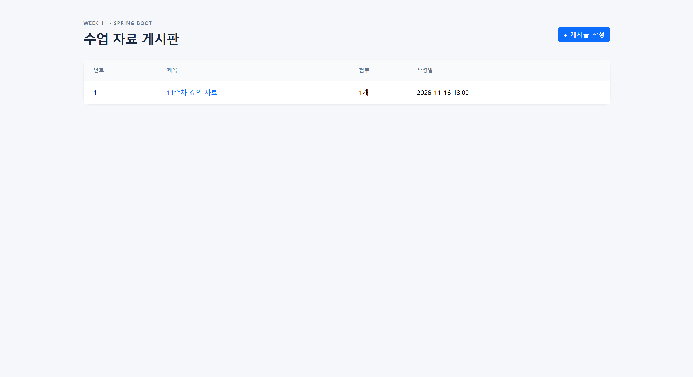
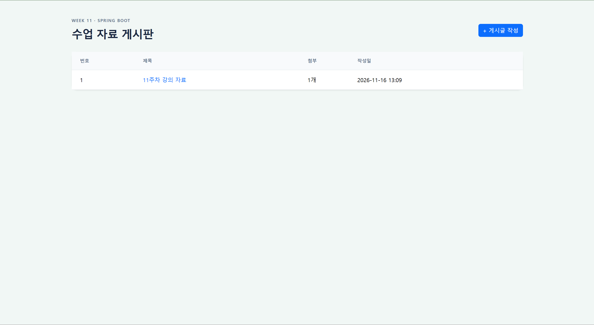
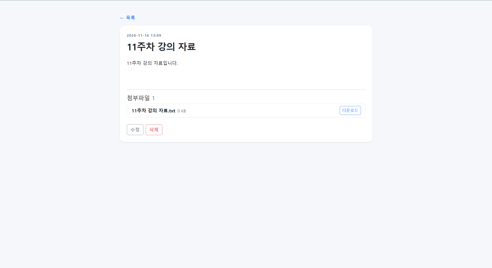
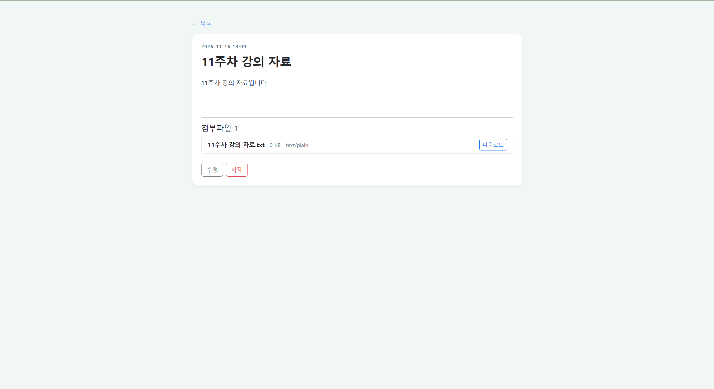
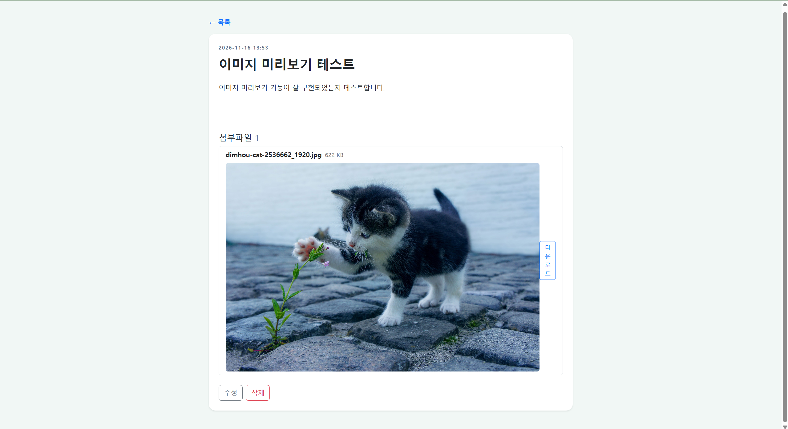
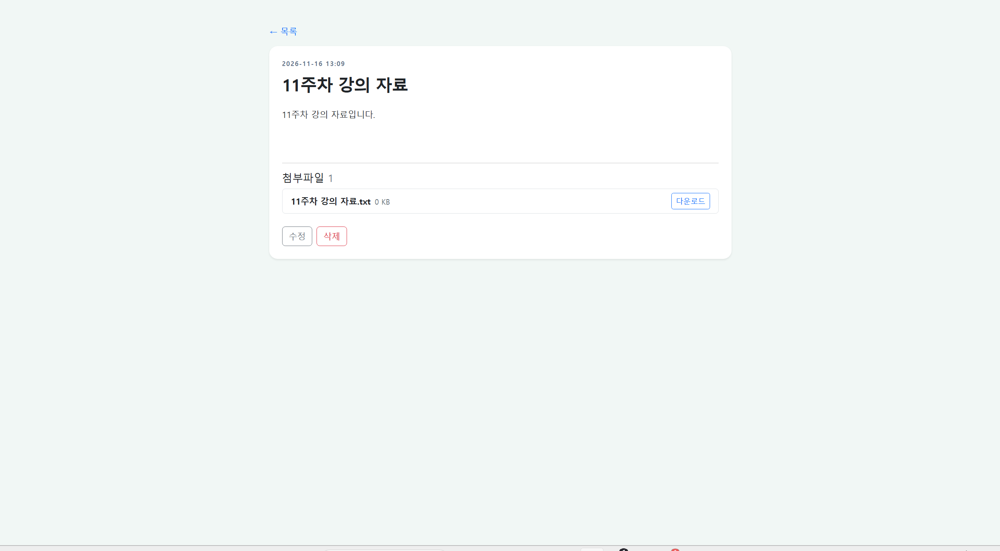
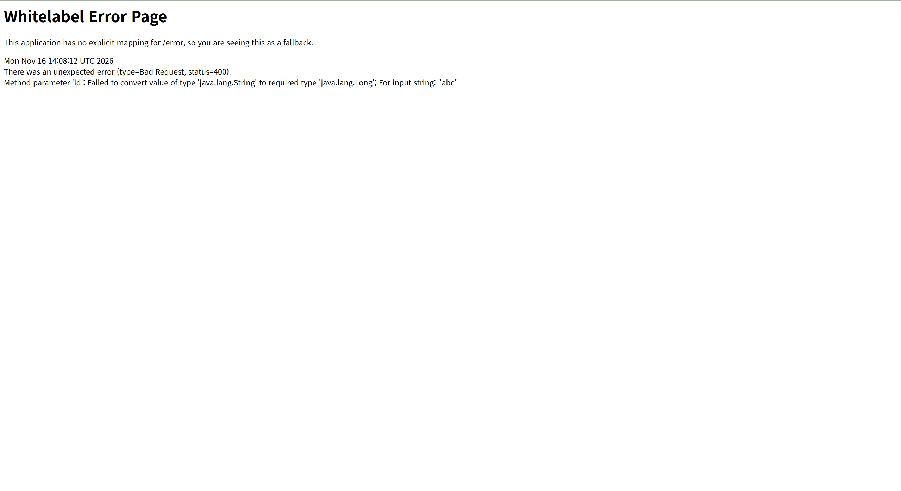

# Customizing 이전의 Sample Project 초기 실행 화면


---

# 1. Project Information
* ## 프로젝트 소개
  **Spring Boot File Upload & Download Customizing & Deployment**
  * 제공된 Spring Boot Sample Project를 바탕으로 파일 업로드·다운로드 기능의 소스코드를 분석
  * Customizing 및 새로운 기능을 구현하여 Render에 배포
* ## GitHub Repository URL
  > https://github.com/dan22200252/week11_sample_project
* ## Render Deployment URL
  > https://week11-sample-project-jq8w.onrender.com/posts

---

# 2. Installation
* ## 환경 설정
  * Java 17과 MariaDB를 사용합니다.
  * DB_URL, DB_USERNAME, DB_PASSWORD는 로컬 시스템 변수와 Render의 Environment Variables에 설정했습니다.

* ## 실행 방법
  * 로컬 실행: IntelliJ에서 AttachmentBoardApplication 실행 후 http://localhost:8080/posts 로 접속합니다.
  * Render에서 접속: https://week11-sample-project-jq8w.onrender.com/posts

---

# 3. Source Code Exploration
## Source Code Analysis
  * **Project Structure & Spring MVC**
    * Q1. PostController, PostService, PostRepository는 각각 어떤 역할을 하며, 서로 어떻게 연결되는가? 
    ```text
    PostController는 게시글 요청을 받아 PostService에 전달하고 결과에 따라 화면을 결정합니다.
    PostService는 게시글 조회, 작성, 수정 그리고 삭제를 처리합니다. 게시글 데이터는 PostRepository를 통해 다루고 실제 첨부파일은 FileStorageService를 통해 처리합니다.
    PostRepository는 PostService가 DB에서 게시글을 조회, 작성, 수정 그리고 삭제할 수 있는 데이터 접근 기능을 제공합니다.
    - 관련 소스파일: PostController.java, PostService.java, PostRepository.java
    - 관련 메서드: PostController.create(), PostService.create(), PostRepository.saveAndFlush()
    ```
    * Q2. 게시글 작성 시 HTML Form의 입력값과 첨부파일은 Controller에 어떻게 전달되는가?
    ```text
    HTML Form의 입력값과 첨부파일은 multipart/form-data 형식으로 한 번에 전달됩니다. 
    PostController.java의 create()는 제목과 본문을 @ModelAttribute로 PostForm에 담고, 첨부파일은 @RequestParam으로 List<MultipartFile>에 담습니다.
    - 관련 소스파일: form.html PostController.java PostForm.java
    - 관련 메서드 또는 확인할 위치: <form>, name="files", PostController.create(), PostForm.title, PostForm.content
    ```

  * **JPA & Entity Relationship**
    * Q1. Post와 Attachment Entity는 어떤 관계이며, @ManyToOne과 @OneToMany는 각각 어떤 역할을 하는가?
    ```text
    Post Entity는 게시글 한 건, Attachment Entity는 첨부파일 한 개의 정보를 나타냅니다. 
    @ManyToOne는 다대일(N:1) 관계를 매핑하고 @OneToMany는 일대다(1:N) 관계를 매핑하는 JPA 어노테이션입니다. 
    게시글 한 건에는 여러 개의 첨부파일이 달릴 수 있고 첨부파일 하나는 게시글 한 건에만 속할 수 있으므로 Post.java의 attachments 필드에는 @OneToMany를, Attachment.java의 post 필드에는 @ManyToOne을 사용합니다.  
    - 관련 소스파일: 	Post.java, Attachment.java
    - 관련 메서드 또는 확인할 위치: Post.attachments, Post.addAttachment(), Attachment.post, Attachment.setPost()
    ```
    * Q2. cascade = CascadeType.ALL과 orphanRemoval = true는 어떤 역할을 하며, 실제 디스크에 저장된 파일에도 영향을 주는가?
    ```text
    JPA에서 cascade = CascadeType.ALL과 orphanRemoval = true는 부모 엔티티와 자식 엔티티 간의 생명주기를 동기화하여 데이터베이스 레코드를 관리하는 기능입니다.
    cascade = CascadeType.ALL은 영속성을 전이하는 코드로 부모 엔티티에서 수행되는 모든 영속성 작업을 자식 엔티티에도 동일하게 적용합니다.
    orphanRemoval = true는 고아 객체를 제거하는 코드로 부모 엔티티와의 관계가 끊어진 자식 엔티티를 자동으로 감지하여 데이터베이스에서 삭제합니다.
    실제 디스크에 저장된 파일에는 영향을 주지 않습니다.
    - 관련 소스파일: Post.java, PostService.java, FileStorageService.java
    - 관련 메서드 또는 확인할 위치: Post.attachments, PostService.delete(), FileStorageService.deleteIfExists()
    ```

  * **File Upload**
    * Q1. MultipartFile은 무엇이며, 업로드된 파일은 어떤 과정을 거쳐 서버에 저장되는가? 
    ```text
    MultipartFile은 Spring Framework에서 HTTP multipart/form-data 요청을 통해 업로드된 파일을 자바 객체로 다루기 위해서 제공하는 인터페이스입니다.
    FileStorageService의 store()는 파일명, 확장자, 크기를 확인하고 UUID 기반 파일명으로 저장 경로를 만든 뒤에 Files.copy()로 파일을 업로드 폴더에 저장합니다.
    - 관련 소스파일: 	PostController.java, PostService.java, FileStorageService.java
    - 관련 메서드: PostController.create(), PostService.create(), FileStorageService.store()
    ```
    * Q2. 파일을 원본 이름 대신 UUID 기반 파일명으로 저장하는 이유는 무엇인가?
    ```text
    UUID를 저장 파일명에 사용하면 여러 사용자가 같은 이름의 파일을 올려도 서로 다른 이름으로 저장할 수 있습니다.
    여러 사용자가 같은 이름의 파일을 업로드할 때 기존 파일이 덮어씌워져 데이터가 유실되는 것을 막아줍니다.
    원본 파일명은 첨부파일 정보에 따로 보관해 다운로드할 때 사용합니다.
    - 관련 소스파일: FileStorageService.java
    - 관련 메서드: store()
    ```
    
  * **File Download & Security**
    * Q1. 파일 다운로드 시 Resource, ResponseEntity, Content-Disposition은 각각 어떤 역할을 하는가?
    ```text
    Resource는 파일을 읽을 수 있게 해주는 객체입니다.
    ResponseEntity는 HTTP 상태 코드, 헤더, 내용물을 담는 전체 응답 객체이며 이 코드에서는 Resource를 본문으로 보냅니다. 
    Content-Disposition은 브라우저에서 다운로드를 지시하고 파일명을 전달하는 헤더입니다.
    - 관련 소스파일: AttachmentController.java, FileStorageService.java
    - 관련 메서드: AttachmentController.download(), FileStorageService.load()
    ```
    * Q2. 파일 저장 과정에서 normalize()와 startsWith()를 사용하는 이유는 무엇인가?
    ```text
    경로 조작 공격을 차단하여 지정된 허용 디렉터리 외부로 파일이 저장되는 것을 막기 위해서입니다.
    normalize()는 경로 문자열에 포함된 .이나 .. 같은 경로 요소를 정리합니다.
    startsWith()는 정리된 저장 경로가 기본 업로드 폴더 경로로 시작하는지 확인합니다.
    - 관련 소스파일: FileStorageService.java
    - 관련 메서드: store()
    ```

---

# 4. Customizing
## Text
### Customizing 전

### Customizing 후


## Style
### Customizing 전

### Customizing 후


## UI/Data
### Customizing 전

### Customizing 후


---

# 5. New Feature: 이미지 미리보기 구현 내용
## 게시글 상세 화면에서 첨부 이미지(jpg, jpeg, png, gif) 표시


## 이미지가 아닌 파일(PDF 등)은 기존 다운로드 기능 유지


## 존재하지 않는 파일 또는 잘못된 파일 ID에 대한 오류 처리
* 존재하지 않는 첨부파일 ID

* 숫자가 아닌 ID

* PDF를 미리보기로 직접 요청


---

# 7. Weekly Review:
* ## 새롭게 배운 내용 3가지
  * 글과 첨부파일을 하나의 요청으로 보내는 방법
    ```text
    게시글 작성 폼에서 multipart/form-data를 사용하면 제목, 본문, 첨부파일을 한 번에 전송할 수 있다는 것을 배웠습니다. 서버는 제목과 본문은 PostForm으로 받고 첨부파일은 List<MultipartFile>로 받습니다.
    ```
  * 다운로드와 이미지 미리보기의 응답 차이
    ```text
    같은 파일이더라도 HTTP 응답을 어떻게 구성하느냐에 따라서 브라우저에서는 다르게 처리된다는 것을 배웠습니다. 다운로드는 Content-Disposition을 attachment로 설정하고 미리보기는 이미지의 Content-Type과 inline을 지정하여서 상세 화면에 표시합니다.
    ```
  * DB의 첨부 정보와 서버의 실제 파일은 따로 저장된다는 점
    ```text
    Render에서 파일명과 유형이 표시되는데 미리보기는 404 오류가 뜨는 상황을 겪었습니다. 이를 통해서 파일명과 크기와 같은 정보가 데이터베이스에 남아있더라도 서버의 저장 폴더에서 실제 파일을 찾을 수 없다면 미리보기가 실패할 수 있다는 사실을 배웠습니다.
    ```

* ## 어려웠던 점과 해결 방법
  * 어려웠던 점
  
    강의자료에 나와있는 이미지 미리보기 html `` 코드를 상세 화면의 어디에 넣어야 하는지, 그 이미지 요청을 Java 코드에서 어떻게 받는지 헷갈리는 경험을 했습니다.
  
  * 해결 방법

    AI와 함께 detail.html의 구조를 살펴보고, 각 첨부파일의 ID를 사용할 수 있도록 ``를 첨부파일 반복문 안에 넣어 해결했습니다.
    
* ## AI 활용 내용 및 느낀 점
  * AI 활용 내용
    ```text
    이미지 미리보기 기능을 구현하는 과정에서 컨트롤러 내 veiw() 메서드를 추가로 작성하는 과정에서 도움을 받았습니다. 
    또한 기존 강의 자료 내에 있는 교수님의 예시 코드를 함께 분석하고 개념을 확립하는 데에도 도움을 받았습니다.
    작성이 완료된 코드 내 오류가 있는지 함께 검토하는 데에도 도움을 받았습니다.
    ```
  * 느낀 점
    ```text
    처음에는  코드를 어디에 넣는지 헷갈렸지만 반복문 안에서 각 첨부파일의 ID를 사용할 수 있고 브라우저가 그 ID로 서버에 이미지를 요청한다는 흐름을 이해할 수 있었습니다.
    AI를 학습 도구로 어떻게 사용하면 더 효율적이고 자기 성장에 도움이 될지 긍정적인 방향으로 잘 활용해 보고 싶습니다.
    ```
